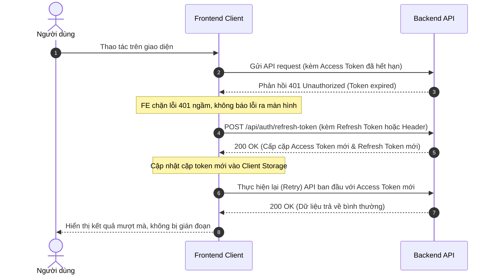

# 📖 TÀI LIỆU ĐẶC TẢ API AUTH CONTROLLER CHO FRONTEND (FE)
> **Dự án:** SketchTale Backend API  
> **Phiên bản:** v2.2  
> **Cập nhật:** 20/10/2026  
> **Tác giả:** Backend Team

---

## 📌 MỤC LỤC
1. [Tổng quan kiến trúc xác thực](#1-tổng-quan-kiến-trúc-xác-thực)
2. [Chi tiết toàn bộ 14 API trong AuthController](#2-chi-tiết-toàn-bộ-14-api-trong-authcontroller)
3. [Cơ chế Logout & Vô hiệu hóa Token tức thì (JWT Blacklist)](#3-cơ-chế-logout--vô-hiệu-hóa-token-tức-thì-jwt-blacklist)
4. [Cơ chế Refresh Token & Luồng xử lý khi hết hạn Access Token](#4-cơ-chế-refresh-token--luồng-xử-lý-khi-hết-hạn-access-token)
5. [Quy chuẩn phân quyền & điều hướng Route theo Role](#5-quy-chuẩn-phân-quyền--điều-hướng-route-theo-role)

---

## 1. TỔNG QUAN KIẾN TRÚC XÁC THỰC

Hệ thống xác thực của SketchTale áp dụng chuẩn JWT kết hợp Refresh Token Rotation:

- **Access Token (JWT):**
  - **Thời hạn sống:** **60 phút** kể từ thời điểm đăng nhập hoặc làm mới.
  - **Mục đích:** Gửi kèm trong mọi request yêu cầu quyền đăng nhập qua HTTP Header:
    ```http
    Authorization: Bearer <access_token>
    ```
  - **Payload:** Chứa thông tin danh tính người dùng (`sub` / `userId`), `username`, `role` và mã định danh phiên (`jti`).

- **Refresh Token:**
  - **Thời hạn sống:** **7 ngày** kể từ thời điểm cấp.
  - **Lưu trữ:** Lưu an toàn trong database (`UserTokens`).
  - **Mục đích:** Dùng để xin cấp mới Access Token mà không cần người dùng nhập lại tài khoản/mật khẩu.

- **Refresh Token Rotation (Cơ chế xoay vòng):**
  - Mỗi khi API cấp lại token thành công, hệ thống sẽ **hủy bỏ Refresh Token hiện tại và sinh ra một Refresh Token mới hoàn toàn**.
  - Giúp phòng chống tấn công lặp lại (Replay Attack) nếu Refresh Token cũ bị lộ.

- **JWT Blacklist (Vô hiệu hóa tức thì):**
  - Khi người dùng Đăng xuất (Logout), Access Token lập tức bị đưa vào Blacklist Cache trên server và Refresh Token trong DB bị xóa.
  - Token cũ bị vô hiệu hóa ngay giây tiếp theo mà không cần chờ hết 60 phút.

---

## 2. CHI TIẾT TOÀN BỘ 14 API TRONG AUTHCONTROLLER

### 2.1. Phụ huynh tự đăng ký tài khoản
- **Endpoint:** `POST /api/auth/register/parent`
- **Quyền hạn:** Public
- **Request Body:**
```json
{
  "username": "phuhuynh_an",
  "email": "phuhuynh_an@gmail.com",
  "password": "Password123@"
}
```
- **Response Success (200 OK):**
```json
{
  "message": "Đăng ký tài khoản phụ huynh thành công! Vui lòng kiểm tra hộp thư email để kích hoạt tài khoản của bạn."
}
```

---

### 2.2. Phụ huynh tạo tài khoản cho con (Child)
- **Endpoint:** `POST /api/auth/register/child`
- **Quyền hạn:** `[Authorize(Roles = "Parent,parent")]` *(Bắt buộc đăng nhập tài khoản Phụ huynh)*
- **Header:** `Authorization: Bearer <parent_access_token>`
- **Request Body:**
```json
{
  "username": "be_bin",
  "password": "Password123@",
  "nickName": "Bé Bin"
}
```
- **Response Success (200 OK):**
```json
{
  "message": "Tạo tài khoản cho con thành công!"
}
```

---

### 2.3. Đăng nhập chung (Admin, ContentManager, Parent)
- **Endpoint:** `POST /api/auth/login`
- **Quyền hạn:** Public
- **Mô tả:** Trường `identifier` có thể nhập **Email** hoặc **Username**.
- **Request Body:**
```json
{
  "identifier": "phuhuynh_an@gmail.com",
  "password": "Password123@"
}
```
- **Response Success (200 OK):**
```json
{
  "data": {
    "token": "eyJhbGciOiJIUzI1NiIsInR5cCI6IkpXVCJ9...",
    "refreshToken": "7qT9mX2bL8...",
    "username": "phuhuynh_an",
    "email": "phuhuynh_an@gmail.com",
    "role": "Parent"
  },
  "message": "Đăng nhập thành công!"
}
```
> **FE cần lưu ý:** Cần lưu cả `token` (Access Token) và `refreshToken` vào Client Storage.

---

### 2.4. Đăng nhập riêng cho Trẻ em (Child)
- **Endpoint:** `POST /api/auth/login/child`
- **Quyền hạn:** Public
- **Mô tả:** Trẻ em không sử dụng email, chỉ đăng nhập bằng `username` và `password`.
- **Request Body:**
```json
{
  "username": "be_bin",
  "password": "Password123@"
}
```
- **Response Success (200 OK):**
```json
{
  "data": {
    "token": "eyJhbGciOiJIUzI1NiIsInR5cCI6IkpXVCJ9...",
    "refreshToken": "xP19bLaZ4...",
    "username": "be_bin",
    "email": null,
    "role": "Child"
  },
  "message": "Bé đăng nhập thành công!"
}
```

---

### 2.5. Quên mật khẩu
- **Endpoint:** `POST /api/auth/forgot-password`
- **Quyền hạn:** Public
- **Request Body:**
```json
{
  "email": "phuhuynh_an@gmail.com"
}
```
- **Response Success (200 OK):**
```json
{
  "message": "Nếu email tồn tại trong hệ thống, hướng dẫn đặt lại mật khẩu đã được gửi đến hộp thư của bạn."
}
```

---

### 2.6. Đặt lại mật khẩu (Reset Password)
- **Endpoint:** `POST /api/auth/reset-password`
- **Quyền hạn:** Public
- **Request Body:**
```json
{
  "email": "phuhuynh_an@gmail.com",
  "token": "token_nhan_duoc_tu_email",
  "newPassword": "NewPassword123@"
}
```
- **Response Success (200 OK):**
```json
{
  "message": "Đặt lại mật khẩu thành công! Bạn có thể đăng nhập bằng mật khẩu mới."
}
```

---

### 2.7. Đổi mật khẩu (Khi đã đăng nhập)
- **Endpoint:** `POST /api/auth/change-password`
- **Quyền hạn:** `[Authorize]`
- **Header:** `Authorization: Bearer <access_token>`
- **Request Body:**
```json
{
  "currentPassword": "Password123@",
  "newPassword": "NewPassword456@"
}
```
- **Response Success (200 OK):**
```json
{
  "message": "Đổi mật khẩu thành công!"
}
```

---

### 2.8. Lấy thông tin cá nhân (Profile)
- **Endpoint:** `GET /api/auth/profile`
- **Quyền hạn:** `[Authorize]`
- **Header:** `Authorization: Bearer <access_token>`
- **Response Success (200 OK):**
```json
{
  "data": {
    "id": "8c59f2a4-7221-4ba2-921d-91b456ce43d1",
    "username": "phuhuynh_an",
    "email": "phuhuynh_an@gmail.com",
    "firstName": null,
    "lastName": null,
    "dob": null,
    "gender": null,
    "role": "Parent",
    "createdAt": "2026-10-20T10:15:30",
    "parentProfile": {
      "childProfileLimit": 1,
      "remainingChildProfileLimit": 1,
      "monthlyCreditLimit": 500,
      "remainingMonthlyCreditLimit": 500,
      "canExportStory": false,
      "accessFullStories": false,
      "subscriptionTrialPlusPlan": false
    },
    "childProfile": null
  },
  "message": "Lấy thông tin tài khoản thành công!"
}
```

---

### 2.9. Xác thực email (Nhấp link từ hộp thư)
- **Endpoint:** `GET /api/auth/confirm-email?email=...&token=...`
- **Quyền hạn:** Public
- **Response Success (200 OK):**
```json
{
  "message": "Xác thực email thành công! Tài khoản của bạn đã được kích hoạt. Bạn có thể đăng nhập ngay bây giờ."
}
```

---

### 2.10. Xác thực email (Gửi qua JSON)
- **Endpoint:** `POST /api/auth/confirm-email`
- **Quyền hạn:** Public
- **Request Body:**
```json
{
  "email": "phuhuynh_an@gmail.com",
  "token": "token_xac_thuc"
}
```
- **Response Success (200 OK):**
```json
{
  "message": "Xác thực email thành công! Tài khoản của bạn đã được kích hoạt. Bạn có thể đăng nhập ngay bây giờ."
}
```

---

### 2.11. Gửi lại email xác thực
- **Endpoint:** `POST /api/auth/resend-confirmation-email`
- **Quyền hạn:** Public
- **Request Body:**
```json
{
  "email": "phuhuynh_an@gmail.com"
}
```
- **Response Success (200 OK):**
```json
{
  "message": "Nếu email tồn tại trong hệ thống và chưa được xác thực, email kích hoạt mới đã được gửi."
}
```

---

### 2.12. Đăng xuất (Logout)
- **Endpoint:** `POST /api/auth/logout`
- **Quyền hạn:** `[Authorize]`
- **Header:** `Authorization: Bearer <access_token>`
- **Request Body:** **Không cần truyền body hay param gì cả (No parameters)**
- **Response Success (200 OK):**
```json
{
  "message": "Đăng xuất thành công! Token đã bị vô hiệu hóa."
}
```

---

### 2.13. Cấp mới token (Refresh Token)
- **Endpoint:** `POST /api/auth/refresh-token`
- **Quyền hạn:** `[Authorize]`
- **Header:** `Authorization: Bearer <token>`
- **Request Body:**
  - **Cách 1 (Tự động - Khuyên dùng):** Không cần truyền body gì cả (`No parameters`). Server tự động lấy danh tính user từ Header và tự tra cứu Refresh Token đang có trong DB để cấp mới!
  - **Cách 2 (Thủ công):** Gửi kèm JSON `{ "refreshToken": "<refresh_token>" }`.
- **Response Success (200 OK):**
```json
{
  "data": {
    "token": "eyJhbGciOiJIUzI1NiIsInR5cCI6IkpXVCJ9...<access_token_mới>",
    "refreshToken": "9aX8bK21mL...<refresh_token_mới_đã_xoay_vòng>",
    "username": "phuhuynh_an",
    "email": "phuhuynh_an@gmail.com",
    "role": "Parent"
  },
  "message": "Làm mới token thành công!"
}
```

---

### 2.14. Lấy Role hiện tại của người dùng
- **Endpoint:** `GET /api/auth/current-role`
- **Quyền hạn:** `[Authorize]`
- **Header:** `Authorization: Bearer <access_token>`
- **Response Success (200 OK):**
```json
{
  "data": "Parent",
  "message": "Lấy quyền người dùng thành công!"
}
```
*(Trả về một trong 4 role chuẩn: `"Admin"`, `"ContentManager"`, `"Parent"`, `"Child"`)*

---

## 3. CƠ CHẾ LOGOUT & VÔ HIỆU HÓA TOKEN TỨC THÌ (JWT BLACKLIST)

### Nguyên lý hoạt động:
1. Khi người dùng bấm Logout, phía FE gửi request `POST /api/auth/logout` với header `Authorization: Bearer <access_token>`.
2. Phía Backend sẽ lập tức:
   - Đưa chuỗi token và claim `jti` vào In-Memory Cache (Blacklist) với thời gian tồn tại (TTL) bằng đúng thời gian còn lại của token.
   - Xóa Refresh Token của user khỏi cơ sở dữ liệu (`UserTokens`).
3. Sau thời điểm logout, nếu bất kỳ ai dùng lại Access Token cũ này để gọi bất kỳ API nào, Backend sẽ từ chối ngay lập tức:
   - **HTTP Status:** `401 Unauthorized`
   - **Response Body:**
     ```json
     {
       "message": "Token này đã bị vô hiệu hóa do người dùng đã đăng xuất."
     }
     ```

### Hành vi yêu cầu phía Frontend:
- Gửi request `POST /api/auth/logout`.
- Xóa sạch `accessToken`, `refreshToken` và thông tin `user` khỏi bộ nhớ client (`localStorage` / `sessionStorage` / Cookies).
- Điều hướng người dùng về trang Đăng nhập (`/login`).

---

## 4. CƠ CHẾ REFRESH TOKEN & LUỒNG XỬ LÝ KHI HẾT HẠN ACCESS TOKEN

### Luồng xử lý khuyến nghị cho Frontend:



### Các quy tắc xử lý quan trọng:
1. **Refresh Token Rotation:** Mỗi khi nhận response thành công từ `POST /api/auth/refresh-token`, FE **bắt buộc phải lưu đè cả 2 giá trị mới**: `token` mới và `refreshToken` mới. Không được giữ lại Refresh Token cũ vì token cũ đã bị hủy trên server.
2. **Xử lý khi Refresh Token cũng hết hạn (sau 7 ngày):** Nếu gọi API refresh token mà Backend trả về `401 Unauthorized`, nghĩa là phiên đăng nhập 7 ngày đã kết thúc. Lúc này FE cần xóa dữ liệu xác thực và chuyển hướng người dùng về trang Đăng nhập.
3. **Quản lý hàng đợi request (Request Queue):** Nếu có nhiều API đồng thời nhận lỗi 401, FE nên có cơ chế hàng đợi (queue) để chỉ gọi API refresh token đúng 1 lần duy nhất, sau đó dùng token mới thu được để giải phóng các request đang chờ.

---

## 5. QUY CHUẨN PHÂN QUYỀN & ĐIỀU HƯỚNG ROUTE THEO ROLE

Hệ thống trả về chính xác 1 trong 4 quyền hạn chuẩn trong trường `role`:

| Role | Đối tượng | Phạm vi chức năng trên giao diện |
| :--- | :--- | :--- |
| **`Parent`** | Phụ huynh | Quản lý gia đình, tạo hồ sơ con cái, theo dõi tiến trình học của bé, mua/gia hạn các gói dịch vụ (Subscription). |
| **`Child`** | Trẻ em | Đọc truyện tương tác, làm câu đố (Quiz), học từ vựng và tham gia các hoạt động vẽ tranh của bé. |
| **`Admin`** | Quản trị viên | Quản lý toàn bộ người dùng, cấu hình gói dịch vụ, bảng giá credit, kiểm duyệt báo cáo nội dung. |
| **`ContentManager`** | Biên tập viên | Quản lý và kiểm duyệt bản mẫu truyện (`StoryTemplate`), trang truyện, câu đố, từ vựng và chủ đề giáo dục. |

---
*Tài liệu này được tạo tự động bởi hệ thống và dùng cho việc đối soát, tích hợp giữa Frontend và Backend.*
